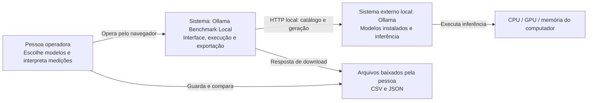
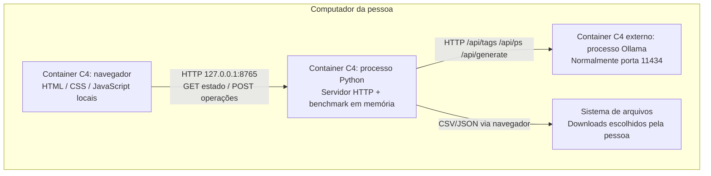
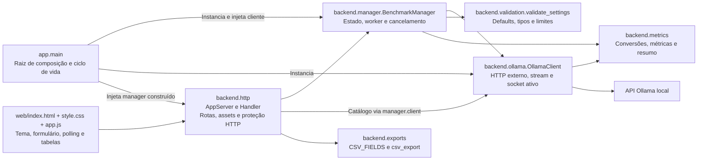
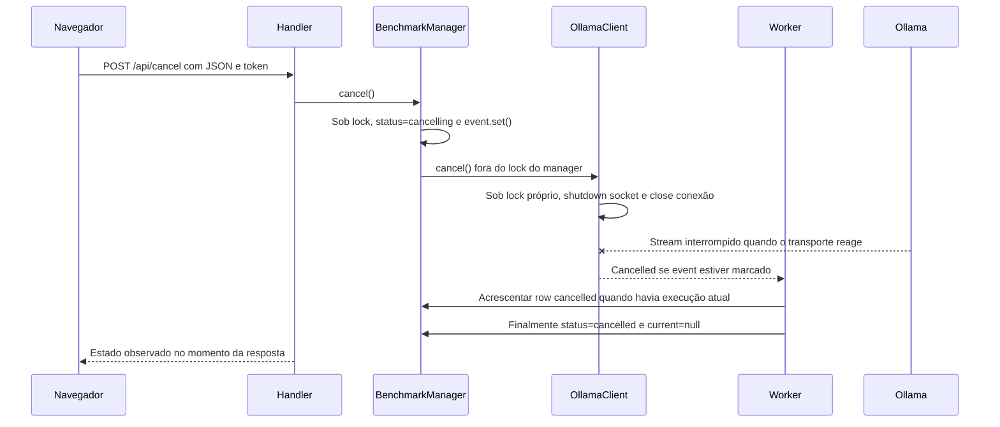
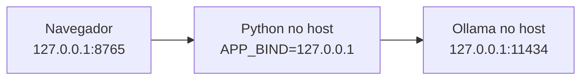
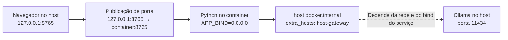
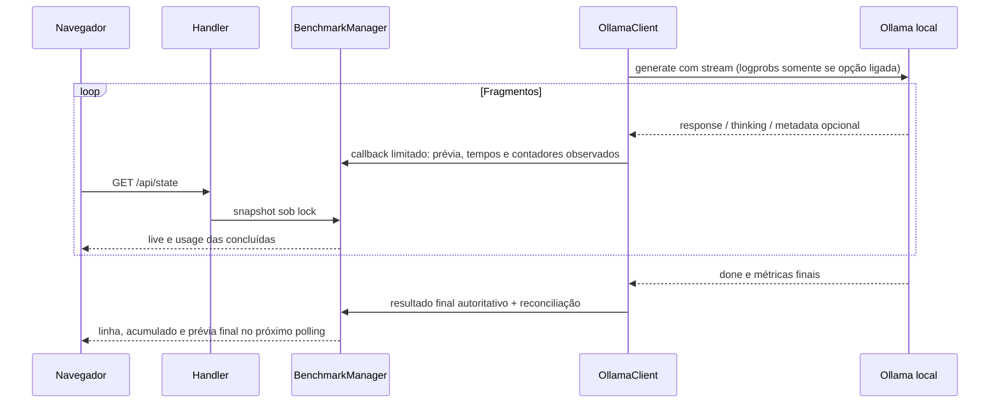
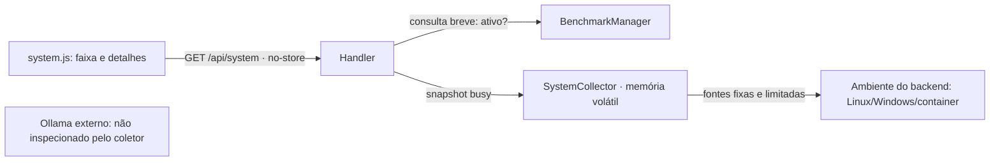

# Arquitetura — Ollama Benchmark Local

## 1. Baseline e finalidade

Este documento descreve a arquitetura da baseline de **28/10/2026**, atualizada pela [mudança SDD-001](changes/001-separacao-responsabilidades.md). A baseline inicial foi reconstruída retrospectivamente. A separação de responsabilidades do backend, por sua vez, foi especificada antes da alteração de código, sob demanda explícita. A fonte primária atual é [app.py](../app.py), o pacote [backend](../backend/), [web](../web/) e os dois arquivos Compose. Especificação não equivale a validação: os gates e a evidência da refatoração devem acompanhar a [rastreabilidade](rastreabilidade.md). Evoluções seguem o processo da [SDD](sdd.md).

A aplicação mede a geração de modelos de um Ollama já instalado no computador. O sistema medido é externo ao app: o benchmark envia pedidos e calcula/organiza métricas; quem carrega os pesos e utiliza CPU/GPU é o Ollama.

**Direcionadores:** dependência Python somente da biblioteca padrão; operação pessoal local; interface web comum a Windows/Linux; métricas auditáveis; comparação sequencial; instalação e manutenção pequenas. Contratos e limites completos ficam na [especificação técnica](especificacao-tecnica.md), sem duplicação de schemas aqui.

## 2. C4 — contexto

Os diagramas usam `flowchart` e `sequenceDiagram` Mermaid comuns, sem extensões C4. Os rótulos identificam os níveis C4 de forma conceitual.



Não há serviço de nuvem, conta, autenticação de usuário, telemetria, download de modelos ou banco de dados na arquitetura. A conexão com Ollama é feita pelo processo Python, não diretamente pelo navegador.

### Extensão PWA (SDD-002)

`web/pwa.js` registra `web/sw.js` e adapta o evento de instalação do navegador. `manifest.webmanifest` define identidade e ícones; `backend.http.STATIC_ASSETS` restringe as novas rotas e tipos MIME. Ícones PNG são entregues como bytes, sem decodificação de texto. O service worker persiste somente oito assets públicos, nunca HTML principal com token ou APIs. Navegações principais usam rede com fallback para `offline.html`, que explica como iniciar o servidor. Benchmarks não funcionam offline. CSP restringe imagens, manifesto e worker à mesma origem.

## 3. C4 — containers de execução

Neste nível, “container” significa unidade executável no modelo C4. O servidor Python pode ou não estar em um container Docker.



Uma instância Python possui um único `BenchmarkManager` e um único estado compartilhado. Duas abas enxergam a mesma comparação; não existem sessões de negócio, identificador de job, filas por pessoa ou histórico de comparações. Iniciar outra comparação substitui os resultados da anterior. A exportação é a fronteira de retenção escolhida pelo operador.

## 4. C4 — componentes e dependências internas



| Unidade | Responsabilidade e estado | Dependências principais |
| --- | --- | --- |
| [app.main](../app.py) | Raiz de composição: ler CLI/ambiente, construir cliente → manager → servidor, abrir navegador e encerrar | `argparse`, `os`, `webbrowser`, `threading` e classes concretas do pacote backend |
| [backend.http.AppServer](../backend/http.py) | Receber o manager já construído; possuir token da instância e conjunto de `Host` aceitos | `ThreadingHTTPServer`, `secrets` |
| [backend.http.Handler](../backend/http.py) | Adaptar rotas, servir assets públicos por mapa explícito, validar entrada HTTP e enviar respostas | `BaseHTTPRequestHandler`, `json`, `urllib.parse`, exportação CSV |
| [backend.manager.BenchmarkManager](../backend/manager.py) | Autorizar um teste por vez, preparar fila, publicar resultados e snapshots | Cliente injetado por duck typing, validação, resumo, `threading`, `copy`, `datetime` |
| [backend.ollama.OllamaClient e Cancelled](../backend/ollama.py) | Restringir destino, chamar Ollama e ler NDJSON com medição, cancelamento e deadline | `http.client`, `socket`, `threading`, `time` e função de métricas |
| [backend.validation.validate_settings](../backend/validation.py) | Validar tipos/limites, aplicar defaults e normalizar modelos | Biblioteca padrão, sem transporte ou estado de job |
| [backend.metrics](../backend/metrics.py) | `seconds`, `metrics` e `summarize`: unidades, velocidade e mediana das repetições concluídas | `math`, `statistics`, sem HTTP ou criação de threads |
| [backend.exports](../backend/exports.py) | `CSV_FIELDS` e `csv_export`: representar snapshot em CSV e neutralizar fórmulas | `csv`, `io`, sem iniciar inferência |
| [backend.__init__](../backend/__init__.py) | Identificar o pacote, sem reexportações de conveniência | Nenhuma composição ou interface de extensão |
| [web/app.js](../web/app.js) | Inicializar tema, consumir API mesma origem, desabilitar edição durante teste e renderizar com `textContent` | APIs nativas `matchMedia`, `localStorage`, `fetch`, DOM e timers do navegador |

A inspeção pós-extração confirmou os sete módulos do pacote, o caminho de assets calculado pela pasta pai de `backend/http.py`, os imports atualizados da suíte e a cópia do pacote no Dockerfile. O teste `CliTests.test_cli_starts_composition_root_without_ollama` cobre a montagem via subprocesso; seu resultado deve ser registrado nos gates, sem confundir presença do teste com aprovação.

A composição concreta fica em `main`: `OllamaClient` recebe o destino, `BenchmarkManager` recebe o cliente e `AppServer(address, manager)` recebe o manager. A borda HTTP não constrói cliente ou manager. A descoberta de modelos continua usando `manager.client` diretamente, preservando o comportamento existente; não foi inventado um serviço de catálogo ou uma factory para essa movimentação.

A separação introduz fronteiras de módulos por motivos de mudança; não transforma o produto em microsserviços nem cria plugins, classes abstratas ou uma arquitetura hexagonal formal. O antigo `benchmark.py` deixa de existir e seus consumidores internos passam a importar os módulos correspondentes. A entrada operacional `python app.py` permanece. Consulte a [revisão SOLID](revisao-solid.md) e o [ADR-005](adr/005-separacao-responsabilidades-backend.md) para benefícios e limites reais.

### 4.1 Inicialização e preferência de tema

O seletor **Tema** no cabeçalho oferece **Claro** e **Escuro**. Esse recurso pertence somente ao cliente web: não acrescenta endpoints, campos no estado Python ou parâmetros enviados ao Ollama.

Na SDD-003, a inicialização de tema foi extraída para `/help.js`, compartilhado com a FAQ. A página carrega `/help.js` como script externo síncrono no `<head>`, antes de `/style.css`. Uma IIFE nesse script público lê a preferência e define `document.documentElement.dataset.theme` antes de a página completar o carregamento. A intenção é aplicar a escolha antes da primeira renderização completa; não se promete ausência de transição visual em qualquer navegador ou condição de rede. O restante da aplicação, incluindo controles, catálogo e polling, aguarda `DOMContentLoaded`.

A precedência implementada é:

1. Valor `light` ou `dark` válido na chave `ollama-benchmark-theme` do `localStorage` da origem atual.
2. Na ausência de preferência válida, resultado de `matchMedia('(prefers-color-scheme: dark)')`.
3. Se `matchMedia` não existir, tema claro.

CSS custom properties definem as cores, e `:root[data-theme=dark]` troca os valores. `color-scheme` acompanha o tema para os controles nativos. O seletor tem rótulo e foco visível. A avaliação de pares de contraste é uma verificação específica, não uma certificação integral de acessibilidade; evidências e lacunas devem acompanhar a [rastreabilidade](rastreabilidade.md).

Ao escolher um tema, o código atualiza a página imediatamente e tenta salvar a preferência. Leitura e escrita de `localStorage` possuem `try/catch`: storage bloqueado não impede usar a página. Nesse caso, a escolha fica somente na página corrente e pode voltar à preferência do sistema no próximo carregamento. Uma exceção de storage não é exibida como erro de benchmark.

Mudanças de preferência do sistema são acompanhadas enquanto não houver escolha explícita nessa página ou preferência salva válida. Não há opção **Sistema**, botão de reset, sincronização entre abas pelo evento `storage` ou configuração no servidor. O armazenamento é por origem do navegador: mudar entre `localhost` e `127.0.0.1`, porta ou perfil pode produzir preferências distintas. Para restaurar a escolha automática, a pessoa pode limpar os dados dessa origem nas ferramentas do navegador; o app não fornece esse comando.

A preferência visual é o único dado funcional persistido automaticamente no navegador. Prompts, métricas e resultados continuam na memória do processo Python até substituição/encerramento, salvo exportação manual. O carregamento externo de script e CSS permanece compatível com a CSP existente (`script-src 'self'`, `style-src 'self'`), sem inline scripts, CDN ou dependências novas.

## 5. Sequência de uma comparação

```mermaid
sequenceDiagram
    participant Pessoa
    participant UI as Navegador
    participant HTTP as Handler
    participant M as BenchmarkManager
    participant C as OllamaClient
    participant O as Ollama local
    Pessoa->>UI: Selecionar modelos e parâmetros
    UI->>HTTP: POST /api/start com JSON e token
    HTTP->>M: start(settings)
    M->>M: Validar; adquirir lock; rejeitar se ocupado
    M->>M: Substituir estado e iniciar worker
    HTTP-->>UI: 202 status running
    M->>C: GET /api/tags
    C->>O: Consultar catálogo
    O-->>M: Modelos disponíveis
    loop Para cada modelo e repetição
        M->>M: Publicar current
        M->>C: GET /api/ps
        C->>O: Consultar carregados antes
        M->>C: generate(model, settings, event)
        C->>C: Iniciar relógio e timer de deadline
        C->>O: POST /api/generate stream=true
        O-->>C: Linhas JSON com texto ou raciocínio
        C->>C: Marcar primeiro conteúdo e primeiro texto
        O-->>C: done=true com métricas
        C->>C: Validar prazo e calcular resultado
        C-->>M: Resultado ou exceção
        M->>C: GET /api/ps após sucesso
        M->>M: Acrescentar row sob lock
        UI->>HTTP: GET /api/state por polling
        HTTP->>M: snapshot com cópia profunda
        M-->>UI: Estado e resumo recalculado
    end
    M->>M: Publicar status terminal e current=null juntos
    UI->>HTTP: GET /api/export?format=json ou csv
    HTTP-->>UI: Download do snapshot atual
```

O polling agenda a próxima consulta **700 ms depois de terminar a anterior**; não é uma frequência rígida nem um SLA. A UI mostra progresso por execução. Os fragmentos gerados não são transmitidos ao navegador ao vivo: o Python mede o stream e publica a linha de resultado quando a chamada termina.

Erros de uma execução geram `row.status=failed`, preservam linhas anteriores e permitem continuar a fila. Falha fatal ao consultar/validar o catálogo encerra o teste com `state.status=failed`. `state.status=completed` significa que a fila terminou; não garante que todas as linhas tenham sucesso. Ver estados e regras completos na [SDD](sdd.md).

## 6. Concorrência, consistência e cancelamento

| Executor | Trabalho | Sincronização |
| --- | --- | --- |
| Thread principal | `serve_forever` e encerramento | Ciclo do servidor |
| Threads HTTP | Listagem, snapshots, exportação, início e cancelamento | `BenchmarkManager.lock` nas operações de estado |
| Um worker daemon | Laços ordenados modelo → repetição | Mesmo lock para `current`, append e estado terminal |
| Um timer daemon por geração | Expirar a chamada, inclusive durante fragmentos contínuos | `OllamaClient._lock` protege socket/conexão ativos |
| Timer opcional de abertura | Chamar `webbrowser.open` após aproximadamente 0,5 s | Não participa das medições |

`start` rejeita novo teste enquanto o estado é `running` ou `cancelling`. A validação de parâmetros acontece antes da seção crítica. O estado terminal, o erro fatal e a limpeza de `current` são publicados juntos no `finally` do worker, evitando que a limpeza de um teste antigo altere o seguinte.

`snapshot` copia profundamente o estado sob lock e calcula o resumo fora dele. Exportações e polling recebem uma fotografia consistente naquele instante, inclusive se o benchmark ainda estiver em andamento. A mesma cópia pode conter linhas completas e uma execução atual ainda sem resultado.



**Sem garantia de liberação instantânea da GPU.** O app interrompe seu transporte e não mata processos do Ollama. O servidor Ollama decide quando interromper o trabalho interno. Se o cancelamento ocorrer antes de uma execução começar, pode não existir uma linha `cancelled`; os resultados anteriores continuam disponíveis.

O deadline absoluto começa em `generate`, usa `perf_counter` e tem um timer que faz `shutdown` do socket. Há verificações antes/depois da leitura e antes de aceitar o resultado final. Isso evita aceitar um `done=true` tardio ou ficar preso em uma linha que chega continuamente. O socket e a resposta são fechados no `finally`; o timer é cancelado.

As consultas de metadados antes/depois da geração ficam **fora** desse deadline. Elas usam timeout de socket de cinco segundos e limite de corpo; não têm o mesmo watchdog global. Assim, não se deve interpretar `settings.timeout` como limite absoluto da comparação inteira, nem prometer que qualquer metadado com bytes contínuos termina em cinco segundos. Essa é uma limitação da baseline, não uma alteração proposta de código.

## 7. Dados e fronteiras de confiança

| Fronteira | Dados | Controles implementados | Limites |
| --- | --- | --- | --- |
| Navegador → Python | Parâmetros e comandos | Host exato com porta; Origin presente deve corresponder; rejeição de `cross-site`; POST com token do processo, JSON e limite de corpo | Token protege operações web; não é login ou isolamento entre usuários locais |
| Processo → Ollama | Pedido, parâmetros e respostas NDJSON | Destino HTTP restrito por hostname local; limites de corpo/linha; validação de contagem e duração | Metadados são em parte repassados; app confia no formato do Ollama e registra erros quando inválido |
| Dados → DOM | Modelo, texto e erros | Renderização com `textContent`, CSP e arquivos locais | Não há renderização de Markdown/HTML gerado |
| Estado → CSV | Prompt, modelos e métricas | Writer CSV e prefixo de apóstrofo em strings que possam começar fórmulas | CSV não é formato de round-trip perfeito; use JSON para preservar estrutura |
| Memória → disco | Download solicitado | Exportação explícita pelo navegador | Não há autosave, histórico, recuperação ou criptografia de arquivos |
| Host → container | Rede e arquivos do app | Usuário 65534:65534, read-only, capabilities removidas e no-new-privileges | Rede host no Linux compartilha namespace; container não cria isolamento do Ollama |

O token é criado por processo e injetado na página inicial. Reiniciar o app invalida o token de páginas antigas. GETs não exigem token; os controles de Host/Origin continuam aplicados. Clientes locais sem `Origin` não são recusados só por sua ausência. Não existem cookies de sessão ou permissões por aba.

Os dados retidos no processo são settings, timestamp UTC, linhas e execução atual. Texto visível é limitado a 64.000 caracteres por linha; raciocínio não é armazenado como texto, mas pode marcar o primeiro conteúdo e entrar na contagem de tokens do Ollama. O resumo referencia a primeira linha concluída com `run=1` e calcula medianas independentes para chamadas posteriores concluídas. Memória de GPU informada em `/api/ps` é alocação, não utilização medida.

Os arquivos em `test-results/` (evidências locais não versionadas) são evidências da validação anterior, não armazenamento operacional alimentado automaticamente pelo app. Nenhuma proteção elimina o impacto de outros processos, outras instâncias do benchmark ou outros clientes no mesmo Ollama.

## 8. Implantação

### 8.1 Python nativo



A base operacional é Python 3.11+, navegador e Ollama. O código foi validado com Python 3.12.10 no Linux; Windows continua não verificado. Abrir o navegador automaticamente é uma conveniência de `webbrowser`; a URL impressa permite abertura manual. Não há instalação de dependência Python externa.

### 8.2 Docker Engine nativo no Linux

[compose.linux.yaml](../compose.linux.yaml) é um arquivo independente, não um override para mesclar com o padrão. Usa `network_mode: host`, app em `127.0.0.1:8765` e destino Ollama `127.0.0.1:11434`. Não há `ports`, GPU passthrough, serviço Ollama ou volume persistente.

O [Dockerfile](../Dockerfile) copia `app.py`, o pacote `backend/` e arquivos `web/` para `/app`, usa `python:3.12-slim`, impede escrita de bytecode e executa `python app.py --no-browser` como usuário numérico sem privilégios. A imagem base é uma tag, não um digest imutável; rebuilds futuros podem usar outra revisão da imagem. A execução Linux com Ollama real está evidenciada em `TEST_RESULTS.md` (evidência local não versionada).

### 8.3 Compose padrão e Docker Desktop



[compose.yaml](../compose.yaml) publica somente no loopback do host e usa `host.docker.internal`. A documentação atual do [Docker Compose](https://github.com/docker/compose/blob/main/internal/relay/relay.go), consultada via Context7, descreve a resolução nativa no Desktop e o provisionamento por `host-gateway` no Linux. **Resolução de nome não comprova acesso ao serviço.** Um Ollama restrito ao loopback do host pode não ser alcançável pelo gateway.

O arquivo padrão passou em validação de configuração; Docker Desktop/Windows não foram executados nesta baseline. O projeto não modifica o bind do Ollama nem o firewall para contornar isso. Quando o gateway não alcança o Ollama, a alternativa documentada é Python nativo; no Linux com Engine nativo, usar o arquivo host-network. Os dois modos não devem rodar juntos na mesma porta.

## 9. Qualidade, falhas e capacidade

A baseline anterior à separação de módulos possuía 24 testes unitários/HTTP simulado, integração real nativa e em Docker Linux, cancelamento, exportações e layouts móvel/tablet/desktop. A SDD-001 preserva esses cenários e exige ainda teste da raiz de composição por CLI; a quantidade e o resultado final da suíte refatorada devem ser consultados na matriz de rastreabilidade, sem reaproveitar a aprovação antiga como aprovação automática do código novo. Consulte [rastreabilidade](rastreabilidade.md) e `TEST_RESULTS.md` (evidência local não versionada) para distinguir teste automatizado, inspeção e medição pontual. Esta documentação não executou novos benchmarks ou reinicializações.

Não há meta contratual de tokens/s ou primeiro token: esses valores pertencem ao modelo, hardware, cache, contexto e carga corrente. O app não valida qualidade semântica da resposta. Os limites de parâmetros e payload restringem trabalho e tamanho por entrada; não existe orçamento global de memória/CPU ou proteção para uso público.

Não há log de acesso HTTP por requisição: `Handler.log_message` é suprimido. O terminal informa a URL e o encerramento; erros de teste ficam em estado/linhas. Para diagnóstico, exporte antes de reiniciar e siga o [runbook](operacao.md).

## 10. Decisões e evolução

- [ADR-001 — Python padrão e web local](adr/001-python-stdlib-web-local.md).
- [ADR-002 — Estado transitório e execução sequencial](adr/002-execucao-sequencial-estado-transitorio.md).
- [ADR-003 — Fronteira HTTP local e proteção de operações](adr/003-fronteira-local-e-protecao-http.md).
- [ADR-004 — Docker opcional e redes independentes](adr/004-docker-opcional-redes.md).
- [ADR-005 — Separação de responsabilidades do backend](adr/005-separacao-responsabilidades-backend.md), sob demanda explícita e especificada antes do código.

Mudanças em persistência, múltiplos usuários, execução paralela, destinos remotos, monitoramento de hardware ou frameworks alterariam decisões centrais. Devem partir de requisito e ADR novos, revisar o contrato técnico e a estratégia de testes antes de implementação. São possibilidades de evolução, não itens entregues ou automaticamente aprovados.

## 14. Evolução SDD-003: progresso e ajuda pública

O fluxo continua navegador → HTTP → manager → cliente Ollama. `OllamaClient.generate` recebe um callback opcional `progress`; a captura de TTFT continua próxima da leitura do stream. O callback publica apenas texto limitado, contagens e tempos, com throttle de 250 ms e publicação inicial/final garantida. `BenchmarkManager` atualiza `live` sob lock e deriva cronômetro monotônico no snapshot; `usage` é calculado das linhas completed. O polling existente da UI consome essas novas representações, sem SSE/WebSocket, thread de monitoramento ou observação de outros clientes.



Instrumentação é opt-in (`live_token_count=false` por padrão). Ao ligar, o cliente pede `logprobs=true/top_logprobs=0` e conta entradas válidas, sem guardar probabilidades/bytes/conteúdo dos tokens. Qualquer conteúdo sem metadata válida invalida a observação completa; não há retry. `eval_count` final prevalece. O trade-off é mais informação de saída ao vivo com potencial sobrecarga e compatibilidade variável; essa opção precisa acompanhar comparações/exportações.

Prévia incompleta fica na memória até ser substituída, inclusive em falha/cancelamento, e pode aparecer no JSON exportado. Texto de thinking e metadata bruta não entram no estado. O frontend mantém textContent e não anuncia cada fragmento ao leitor de tela por uma região de texto aria-live de alto volume.

A fronteira pública da PWA acrescenta FAQ estática e help.js, sem token nem consumo de API. Help.js contém somente tema e tooltips; app.js permanece responsável pelo benchmark. SW v2 armazena dez assets públicos explícitos, sem página principal, APIs, prévia, prompt, resposta ou exportações. Fontes externas na FAQ são links abertos por ação do usuário, sem fetch/CDN na página.

A avaliação Windows está registrada em [TASK-WIN-01](backlog.md): reutilizar o Compose padrão até que um teste real demonstre necessidade de arquivo específico. Não há nova configuração Docker nesta mudança.

## 15. Evolução SDD-004: resumo separado do ambiente

`app.main` compõe o novo `SystemCollector`, independente do manager/cliente Ollama, e injeta em AppServer. A borda oferece `/api/system` com proteções comuns e consulta `manager.is_active()` somente para decidir pausa. Fatos estáticos por instância e cache dinâmico de dez segundos ficam exclusivamente no coletor, sem inserir inventário em estado, linhas, CSV/JSON ou service worker.



O alvo Ollama aparece apenas como fronteira externa não inspecionada; não existe uma integração de inventário com ele. Não há subprocesso arbitrário, serviço de sistema, dependência neofetch/fastfetch, Docker socket, privilégio ou montagem sensível. Nomes de campos são uma allowlist; falhas deixam desconhecidos em vez de expor dados brutos. Fontes e relógio injetáveis permitem testes completamente sintéticos dos coletores.

Coleta dinâmica ocorre fora dos locks. Solicitações concorrentes e teste ativo reutilizam o último snapshot com flags; este mecanismo reduz interferência, sem prometer isolamento absoluto de recursos do sistema. No Docker, CPU/kernel podem ser compartilhados e RAM só recebe capacidade num escopo comprovável; host/Ollama não são presumidos equivalentes ao container.

A faixa mantém a identidade visual do app em vez de criar um dashboard genérico: origem/SO, CPU/GPU/RAM separados em uma superfície, RAM com barra somente quando conhecida, detalhes inline responsivos e números tabulares. Scopes técnicos são traduzidos, nomes completos permanecem nos detalhes e o resumo pode abreviar prefixos redundantes somente para legibilidade. Hover-out sem pin/foco fecha após breve intervalo; botão/toque, Escape e Fechar preservam navegação sem modal ou focus trap.

`system.js` é script público genérico separado, mas fica fora do cache; a FAQ não o carrega. SW v3 mantém dez assets públicos e nunca inventário ou `/api/system`. Contrato e minimização estão na [SDD-004](changes/004-resumo-ambiente-dinamico.md), [especificação](especificacao-tecnica.md) e [privacidade](../PRIVACY.md).

## Biblioteca e nome local (SDD-005/006)

`prompts.js` reúne catálogo sintético e controlador do dialog nativo; `prompts.css` usa os temas existentes. O módulo só escreve no textarea por ação final e não depende do cliente Ollama. Escuta benchmark-status e revalida o estado local antes da aplicação. O servidor serve os dois assets pela whitelist; não existe API de catálogo, storage ou caminho de inferência novo. Os assets ficam fora do cache PWA v3.

`SystemCollector` acrescenta hostname por socket.gethostname sem DNS, uma vez por instância, com sanitização e null em falha. É a única exceção de identificação local solicitada na SDD-006. O DOM rotula máquina/container; o campo permanece no inventário volátil separado do manager, CSV/JSON e cache.
