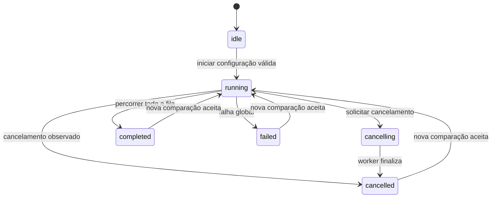

# SDD — especificação de produto e comportamento

## 1. Identificação e autoridade desta especificação

| Campo | Valor |
| --- | --- |
| Produto | Ollama Benchmark Local |
| Baseline documental | 28/10/2026 |
| Natureza | Especificação retrospectiva da implementação existente, seguida de processo spec-first para mudanças futuras |
| Público | Responsável pelo produto, desenvolvimento, testes, revisão e operação local |
| Evidência de implementação | `app.py`, `backend/`, `web/`, `tests/test_benchmark.py`, arquivos Docker/Compose e relatório local `TEST_RESULTS.md` (não versionado) |
| Estado | Comportamento implementado descrito a partir dos arquivos atuais; lacunas de validação identificadas neste documento |

**Esta baseline não comprova que a entrega inicial foi conduzida integralmente por SDD.** A refatoração desta rodada possui especificação prospectiva própria, [SDD-001](changes/001-separacao-responsabilidades.md), registrada antes das alterações de código. O código e seus testes já existiam quando esta documentação foi solicitada. Os requisitos abaixo organizam o comportamento observado para permitir manutenção orientada por especificação daqui em diante. Não constituem autorização para implementar novas funcionalidades.

Documentos complementares:

- [Índice da documentação](README.md): navegação e responsabilidades dos documentos.
- [Arquitetura](arquitetura.md): componentes, execução, fronteiras e decisões.
- [Especificação técnica](especificacao-tecnica.md): contratos HTTP, estruturas de dados, algoritmos e limites exatos.
- [Rastreabilidade](rastreabilidade.md): requisito, código, teste e evidência.
- `TEST_RESULTS.md`: relatório local de execução real e limitações verificadas; arquivo não versionado e não publicado com o código.

Quando uma mudança tornar código e especificação divergentes, a equipe deve identificar a divergência, decidir o comportamento desejado e atualizar especificação, implementação e testes no mesmo conjunto de alterações. Não é permitido tratar uma hipótese deste documento como evidência de execução em uma plataforma.

## 2. Visão, problema e valor

A pessoa usuária precisa comparar o desempenho dos modelos já instalados em seu Ollama local sem executar scripts manualmente a cada medição. Uma resposta aparentemente lenta pode refletir carregamento do modelo, processamento de entrada, geração ou raciocínio antes do texto visível. Mostrar apenas o tempo total esconde essas diferenças.

O produto oferece uma interface no navegador para selecionar modelos, repetir o mesmo pedido, medir velocidades e tempos e exportar resultados. O servidor local usa apenas a biblioteca padrão do Python. O Ollama permanece um serviço externo já instalado na mesma máquina.

### Objetivos

1. Tornar reproduzível uma comparação local, registrando os parâmetros e as métricas de cada execução.
2. Separar geração, carregamento, processamento de entrada, primeiro conteúdo e primeiro texto visível.
3. Distinguir a primeira chamada de cada modelo das chamadas seguintes sem prometer cache frio.
4. Preservar resultados concluídos quando outra execução falhar ou o teste for cancelado.
5. Permitir operação pessoal local sem pacotes Python externos, mantendo Docker opcional.

### Indicadores de sucesso e limites dos indicadores

| Indicador | Critério observável |
| --- | --- |
| Comparação concluída | Uma seleção de modelos produz registros individuais e resumo, usando os parâmetros enviados |
| Integridade numérica | Tokens/s corresponde à contagem final de tokens dividida pelo tempo de geração do Ollama; durações inválidas não produzem taxas fictícias |
| Explicação da espera | A interface e o JSON distinguem primeiro conteúdo, primeiro texto, carga, prompt, geração e total |
| Recuperação operacional | Cancelamento impede próximas chamadas e outro teste pode iniciar depois do encerramento |
| Portabilidade de instalação | Execução nativa não requer `pip`, Node ou Docker; Windows continua sujeito à validação real pendente |
| Auditabilidade | CSV/JSON permitem recuperar parâmetros e resultados individuais; o JSON também preserva o resumo e o texto registrado |

Não há uma meta de tokens/s, um SLA de inferência ou uma garantia de tempo de resposta do modelo. A velocidade depende do hardware, modelo, quantização, contexto, cache e carga concorrente.

## 3. Atores e responsabilidades

| Ator | Objetivo e responsabilidade |
| --- | --- |
| Pessoa usuária local | Selecionar modelos, definir um pedido comparável, iniciar/cancelar testes e exportar dados antes de substituí-los |
| Responsável pela manutenção | Evoluir especificação, código e testes sem introduzir dependências fora da restrição do produto |
| QA/revisor | Conferir critérios verificáveis, rastreabilidade e evidências; distinguir teste simulado de integração real |
| Ollama local | Informar modelos instalados/carregados e executar as inferências; determina suporte a modelos, raciocínio e alocação de memória |
| Navegador | Exibir a interface e consultar o processo local; não acessa diretamente o Ollama |

Não há contas, perfis, autenticação de usuários, projetos compartilhados ou isolamento entre pessoas. O token da página protege operações HTTP do processo; não representa um sistema de identidade.

## 4. Escopo da baseline

### Incluído

- Descoberta dos modelos disponíveis no Ollama local e indicação dos modelos carregados.
- Seleção de um ou mais modelos e configuração de pedido, limite de saída, contexto, repetições, timeout e raciocínio.
- Inferências sequenciais com parâmetros comuns e identificação de cada modelo/execução.
- Métricas numéricas por execução, resumo das chamadas repetidas e separação da primeira chamada.
- Progresso por execução, mensagens de falha, texto final registrado e cancelamento.
- Exportação CSV e JSON do estado disponível na memória.
- Interface local em português e layout com tabelas roláveis.
- Extensão solicitada nesta rodada: seleção de tema claro/escuro com preferência local; implementada nesta rodada e validada nos cenários de navegador registrados na rastreabilidade.
- Execução nativa com Python e execução opcional do app em container, mantendo Ollama no host.

### Excluído

- Instalação, atualização, download, conversão ou alteração de modelos e configurações do Ollama.
- Garantia de descarregamento de modelos, cache frio ou ausência de outros clientes Ollama.
- Inferência remota arbitrária, publicação na internet, acesso por rede local ou serviço multiusuário.
- Comparação forçada CPU versus GPU, seleção de backend Vulkan/ROCm ou coleta portátil de utilização da GPU.
- Avaliação de qualidade, correção, segurança ou pertinência do conteúdo gerado pelos modelos.
- Testes de carga simultânea, processamento em paralelo ou comparação estatística entre hardware diferente.
- Banco de dados, histórico persistente, importação de resultados e recuperação após reiniciar o processo.
- Gráficos, instalador executável, aplicação móvel ou pacote desktop nativo.
- Comprovação de compatibilidade com Windows e Docker Desktop sem execução nesses ambientes.

Os itens excluídos não constituem um backlog aprovado. Uma futura inclusão exige demanda, critérios de aceite e análise de impacto.

## 5. Requisitos funcionais

O termo **deve** descreve o comportamento da baseline ou um critério para preservá-lo em futuras alterações. A coluna de observação impede interpretar capacidade implementada como validação universal.

| ID | Requisito verificável | Observação da baseline |
| --- | --- | --- |
| RF-01 | O app deve consultar o Ollama configurado, listar seus modelos instalados e informar indisponibilidade ou lista vazia. | A listagem não instala modelos; erros de conexão são informados ao usuário. |
| RF-02 | A pessoa usuária deve selecionar modelos e fornecer parâmetros válidos antes de iniciar a comparação. | Limites e tipos estão na especificação técnica; o backend revalida entradas. |
| RF-03 | O app deve executar os modelos selecionados e suas repetições de forma sequencial, mantendo o mesmo pedido e os mesmos parâmetros de geração. | A ordem dos modelos é preservada após remover duplicatas; cada modelo inicia sua numeração em 1. |
| RF-04 | Cada execução concluída deve registrar contagem de tokens, tokens/s, primeiro conteúdo, primeiro texto, total medido e durações fornecidas pelo Ollama. | Valores ausentes ou inválidos podem resultar em `null`; a contagem de saída precisa ser válida. |
| RF-05 | A interface deve apresentar estado global, execução atual, quantidade de registros finalizados, tabela individual e texto/erro registrado. | A atualização é por consulta periódica; não é exibição incremental token a token. |
| RF-06 | O app deve separar a primeira chamada e resumir chamadas de número maior que 1, usando apenas execuções concluídas. | Cada métrica do resumo usa a mediana dos seus valores numéricos disponíveis. |
| RF-07 | A pessoa usuária deve poder solicitar cancelamento de um teste em andamento. | O app impede novas inferências da fila e tenta interromper a conexão atual; não garante liberação imediata de recursos do Ollama. |
| RF-08 | Falhas individuais devem ser registradas sem apagar resultados anteriores; falhas globais devem ter estado e mensagem próprios. | Encerramento global `completed` pode conter linhas `failed`; significa que a fila foi percorrida. |
| RF-09 | A pessoa usuária deve exportar o estado disponível em CSV ou JSON. | Exportar durante a execução captura somente o estado disponível naquele momento. |
| RF-10 | O app deve operar localmente no navegador, iniciando com Python; Docker deve permanecer uma alternativa opcional. | A API de saúde indica o processo do app, não a saúde do Ollama. |
| RF-11 | O app deve registrar se o modelo estava carregado antes da chamada e obter informações de memória após uma execução concluída quando disponíveis. | Falha na consulta posterior de memória preserva a medição e gera aviso no JSON. |
| RF-12 | A pessoa usuária deve poder habilitar ou desabilitar raciocínio no pedido de benchmark. | A aceitação dessa opção e seu efeito dependem do modelo/Ollama; rejeições são erros individuais, sem adaptação automática. |
| RF-13 | A pessoa usuária deve poder escolher visualmente um tema claro ou escuro; o app deve manter a preferência local quando o armazenamento estiver disponível e usar o tema do sistema na ausência de preferência salva. | Extensão implementada nesta rodada, separada da baseline anterior, com validação de navegador registrada na rastreabilidade. Falha de acesso ao armazenamento não pode impedir a interface ou a escolha na página atual. |

## 6. Requisitos não funcionais

| ID | Requisito | Critério e alcance |
| --- | --- | --- |
| RNF-01 | Dependências mínimas | Código do app e seus testes usam somente a biblioteca padrão do Python; recursos da interface são locais. Python 3.11+ é o mínimo documentado. Navegador e Ollama são requisitos operacionais externos. |
| RNF-02 | Proteção de uso local | A configuração nativa padrão usa loopback. O app valida Host/Origin, rejeita requisição marcada como cross-site e exige token da página para POST. Não é uma garantia de segurança para publicação externa. |
| RNF-03 | Entradas e consumo limitados | O app limita tamanho do corpo HTTP, parâmetros, resposta de metadados, linha do stream e texto preservado. Os valores exatos pertencem à especificação técnica. |
| RNF-04 | Timeout total de geração | Cada inferência deve respeitar seu prazo global também quando dados chegam continuamente; resultados tardios não podem ser aceitos como execução concluída. Consultas de metadados têm timeout próprio. |
| RNF-05 | Consistência do estado | Apenas um teste pode estar ativo por processo. A finalização deve publicar estado terminal e limpeza da execução atual de forma consistente, permitindo novo teste após o encerramento. |
| RNF-06 | Interface utilizável | Controles possuem rótulos, progresso/erro têm semântica de estado/alerta e tabelas largas têm rolagem própria. A extensão de tema deve preservar legibilidade, distinção dos controles e foco visível nas duas alternativas. Há evidência de layout em três tamanhos de viewport e validação dos dois temas nesta rodada, sem certificação formal de acessibilidade. |
| RNF-07 | Portabilidade explicitada | O projeto deve manter caminhos e recursos compatíveis com execução nativa em Windows e Linux. A baseline foi executada em Linux; Windows e Docker Desktop permanecem não verificados. |

## 7. Regras de negócio e interpretação

| ID | Regra |
| --- | --- |
| RN-01 | Uma comparação aplica o mesmo prompt, contexto, limite de saída, opção de raciocínio, temperatura 0 e seed 42 aos modelos selecionados. Isso reduz diferenças de configuração, sem garantir conteúdo idêntico entre modelos/plataformas. |
| RN-02 | Tokens são os contadores finais retornados pelo Ollama. Fragmentos do stream não são tokens. Tokens/s usa somente o tempo de geração informado, não o tempo total medido no cliente. |
| RN-03 | A execução 1 de cada modelo é a primeira chamada daquele teste, inclusive se o modelo já estiver carregado. Ela não prova cache frio nem mede inicialização do computador. |
| RN-04 | Resumos excluem a execução 1 e registros não concluídos. A mediana de cada métrica ignora valores não numéricos; não depende de a consulta anterior ter classificado o modelo como carregado. |
| RN-05 | Existe no máximo um teste ativo por processo do app. Uma nova solicitação é rejeitada enquanto o teste estiver `running` ou `cancelling`. Abas do mesmo app compartilham o mesmo estado. |
| RN-06 | Cancelar significa interromper a fila e tentar fechar a conexão de inferência. A solicitação não equivale a confirmar que o Ollama já parou a computação ou liberou memória. |
| RN-07 | O app não baixa modelos nem reconfigura o Ollama. Solicita que o modelo gerado permaneça carregado por dois minutos; a política real de alocação e eventual remoção de outros modelos continua a cargo do Ollama. |
| RN-08 | Informações de memória do modelo/GPU são alocações informadas pelo Ollama. Não demonstram percentual de uso, atividade instantânea, backend computacional ou benefício de desempenho da GPU. |
| RN-09 | O estado é volátil. Uma nova comparação aceita substitui o estado anterior e reiniciar o processo o perde. Exportar é a ação disponível para guardar resultados; falhar depois da aceitação não recupera o teste anterior. |
| RN-10 | Outros processos podem usar o mesmo Ollama. O app não fornece isolamento; carga, cache, filas e mudanças de memória externas podem influenciar a medição. |

## 8. Histórias e critérios de aceite BDD

US-01 a US-08 descrevem a baseline implementada e têm prioridade P0 para preservação. US-09 descreve a extensão de tema implementada nesta rodada e validada nos cenários de navegador indicados na rastreabilidade. Os exemplos distinguem o comportamento anterior de requisitos novos explícitos. A correspondência com testes automatizados e evidências reais está na [rastreabilidade](rastreabilidade.md).

### US-01 — Descobrir os modelos locais

**Como** pessoa usuária local, **quero** consultar os modelos disponíveis, **para** escolher o que posso medir sem downloads adicionais.

Requisitos: RF-01, RF-10, RF-11; RN-07.

- **Dado** um Ollama acessível com modelos instalados, **quando** eu atualizar a lista, **então** verei esses modelos e a indicação de carregamento disponível.
- **Dado** um Ollama acessível sem modelos, **quando** eu atualizar a lista, **então** verei que nenhum modelo está instalado e nenhum download será iniciado.
- **Dado** um Ollama indisponível, **quando** a consulta falhar, **então** a interface informará indisponibilidade sem inventar uma lista válida.

### US-02 — Configurar uma comparação válida

**Como** pessoa usuária local, **quero** selecionar modelos e parâmetros, **para** comparar chamadas configuradas da mesma forma.

Requisitos: RF-02, RF-03, RF-12; RNF-03; RN-01.

- **Dado** nenhum modelo selecionado na página, **quando** eu tentar iniciar, **então** receberei a orientação para selecionar pelo menos um modelo.
- **Dado** um pedido HTTP com configuração fora dos limites ou tipos aceitos, **quando** ele for validado, **então** o app rejeitará a configuração antes de iniciar um teste novo.
- **Dado** uma configuração aceita, **quando** o app gerar as chamadas, **então** aplicará os mesmos parâmetros aos modelos e respeitará a opção de raciocínio enviada.
- **Dado** um nome duplicado no pedido HTTP, **quando** a configuração for normalizada, **então** o modelo aparecerá uma única vez, preservando a ordem da primeira ocorrência.

### US-03 — Medir e acompanhar a execução

**Como** pessoa usuária local, **quero** acompanhar cada chamada e seus tempos, **para** distinguir carregamento de velocidade de geração.

Requisitos: RF-03, RF-04, RF-05; RNF-04, RNF-05; RN-02, RN-05.

- **Dado** um teste aceito com dois modelos e duas repetições, **quando** a fila avançar, **então** a primeira chamada do segundo modelo só começará depois das duas chamadas do primeiro.
- **Dado** uma execução atual, **quando** a interface consultar o estado, **então** exibirá o modelo e a execução informados sem contar fragmentos recebidos como tokens.
- **Dado** uma resposta com contagem final de tokens e duração de geração válidas, **quando** a medição terminar, **então** a taxa corresponderá à contagem dividida por essa duração em segundos.
- **Dado** dados chegando continuamente além do prazo configurado de geração, **quando** o prazo expirar, **então** a chamada não será aceita como concluída e a conexão será interrompida por tentativa do cliente.

### US-04 — Entender a primeira chamada e as repetições

**Como** pessoa usuária local, **quero** ver a primeira chamada separada do resumo, **para** não confundir sua demora com as chamadas seguintes.

Requisitos: RF-06, RF-11; RN-03, RN-04, RN-08, RN-10.

- **Dado** um modelo com três chamadas concluídas, **quando** o resumo for calculado, **então** a chamada 1 aparecerá separada e o resumo considerará apenas as chamadas 2 e 3.
- **Dado** uma chamada repetida com falha, **quando** o resumo for calculado, **então** essa chamada não comporá a mediana nem a quantidade de repetições concluídas.
- **Dado** uma métrica ausente em uma repetição concluída, **quando** essa métrica for resumida, **então** apenas seus valores numéricos disponíveis comporão a mediana, ou o resultado será ausente se nenhum existir.
- **Dado** um modelo carregado antes da primeira chamada, **quando** o teste exibir essa chamada, **então** ela continuará identificada como a primeira do teste, sem alegação de cache frio.

### US-05 — Cancelar e executar novamente

**Como** pessoa usuária local, **quero** cancelar um teste demorado, **para** impedir que o restante da fila continue.

Requisitos: RF-07; RNF-05; RN-05, RN-06.

- **Dado** uma inferência em andamento e repetições pendentes, **quando** eu cancelar, **então** o app solicitará o encerramento da conexão e não iniciará as repetições restantes.
- **Dado** um teste ainda em cancelamento, **quando** eu tentar iniciar outro pelo HTTP, **então** a solicitação será rejeitada como conflito.
- **Dado** o encerramento do teste cancelado, **quando** eu iniciar uma nova comparação válida, **então** o novo estado não será modificado pela limpeza do teste anterior.

### US-06 — Receber falhas sem perder medições anteriores

**Como** pessoa usuária local, **quero** entender uma falha e manter o que já foi medido, **para** não descartar toda a comparação por um erro individual.

Requisitos: RF-04, RF-08, RF-11; RNF-04; RN-02.

- **Dado** uma chamada concluída e uma chamada posterior com erro, **quando** o erro ocorrer, **então** o registro concluído permanecerá disponível e a chamada com erro terá seu próprio registro de falha.
- **Dado** um stream encerrado sem mensagem final de métricas, **quando** a leitura terminar, **então** a chamada será uma falha e não terá uma velocidade estimada por contagem de fragmentos.
- **Dado** uma duração de geração zero ou ausente, **quando** houver contagem válida de tokens, **então** a velocidade será ausente, não infinita nem fabricada.
- **Dado** uma medição concluída cuja consulta posterior de memória falhe, **quando** o registro for preservado, **então** suas métricas continuarão concluídas e o JSON conterá um aviso.
- **Dado** um modelo selecionado que não existe mais na listagem do Ollama, **quando** o worker validar a seleção, **então** o teste terminará com erro global sem baixar o modelo.

### US-07 — Guardar resultados para comparação posterior

**Como** pessoa usuária local, **quero** exportar resultados, **para** guardá-los antes de reiniciar ou iniciar outro teste.

Requisitos: RF-09; RN-09.

- **Dado** registros disponíveis, **quando** eu baixar JSON, **então** o arquivo conterá o estado, configurações, resultados individuais e resumo disponíveis no instante da exportação.
- **Dado** registros disponíveis, **quando** eu baixar CSV, **então** cada registro terá uma linha com parâmetros, data e métricas selecionadas, preservando separadores e quebras de linha do conteúdo por escape CSV.
- **Dado** texto iniciado por caractere tratado como fórmula por planilhas, **quando** ele entrar em uma célula CSV exportada, **então** receberá a proteção implementada para reduzir interpretação como fórmula.
- **Dado** um teste aceito após outro teste, **quando** o novo estado for criado, **então** os resultados anteriores deixarão de existir na memória do app; os arquivos previamente exportados permanecerão fora desse ciclo.

### US-08 — Usar a ferramenta somente nesta máquina

**Como** pessoa usuária local, **quero** iniciar o app sem instalar bibliotecas Python, **para** executar a medição em meu ambiente pessoal.

Requisitos: RF-10; RNF-01, RNF-02, RNF-06, RNF-07.

- **Dado** Python, navegador e Ollama instalados, **quando** eu iniciar o modo nativo documentado, **então** a interface será servida no endereço local configurado sem exigir instalação de pacotes Python externos.
- **Dado** uma chamada com Host ou Origin rejeitado, ou POST sem token correto, **quando** o servidor validar a requisição, **então** ela será recusada e não iniciará uma inferência.
- **Dado** uma viewport estreita entre os tamanhos validados, **quando** eu acessar tabelas largas, **então** elas terão rolagem própria sem exigir que toda a página acompanhe sua largura.
- **Dado** a documentação Windows ou Docker Desktop, **quando** a equipe informar compatibilidade, **então** distinguirá instrução implementada de validação ainda pendente nesses ambientes.

### US-09 — Escolher o tema da interface

**Como** pessoa usuária local, **quero** escolher entre interface clara e escura, **para** adequar a leitura à minha preferência e ao ambiente.

Requisitos: RF-13; RNF-01, RNF-06. Estado: alteração solicitada nesta rodada, sem alegação de validação na entrega anterior.

O seletor apresenta somente **Claro** e **Escuro**. Não há opção explícita Sistema nem ação de redefinição nesta extensão. O sistema define o padrão enquanto não houver preferência válida salva; uma escolha explícita tem precedência.

- **Dado** que não existe preferência de tema salva, **quando** eu abrir a página, **então** o tema inicial corresponderá à preferência informada pelo sistema.
- **Dado** o seletor de tema visível, **quando** eu escolher claro ou escuro, **então** a interface adotará essa escolha sem recarregar a página nem interromper o benchmark.
- **Dado** o armazenamento local disponível e uma escolha de tema salva, **quando** eu recarregar a página, **então** a preferência salva prevalecerá sobre o padrão do sistema.
- **Dado** que o navegador bloqueia leitura ou escrita no armazenamento local, **quando** eu abrir a página ou trocar o tema, **então** a interface continuará funcionando e a escolha terá efeito durante a página atual, sem prometer persistência após recarregar.
- **Dado** cada uma das alternativas de tema, **quando** eu usar formulário, seletor, botões, resultados e navegação por teclado, **então** os textos e controles permanecerão distinguíveis e o foco permanecerá visível.
- **Dado** a extensão implementada, **quando** sua revisão conferir os recursos carregados, **então** ela não exigirá dependências externas nem manipuladores de evento inline no HTML.

## 9. Fluxos de produto

### Fluxo principal

1. Iniciar o app e abrir seu endereço local.
2. Consultar conexão/modelos. Se indisponível, informar o erro e permitir tentar atualizar novamente.
3. Selecionar modelos e parâmetros, mantendo em mente as condições da máquina e a influência de outros clientes Ollama.
4. Iniciar uma comparação válida. O estado anterior é substituído pela nova solicitação aceita.
5. Validar a existência dos modelos no worker. Seleção ausente causa falha global.
6. Para cada modelo, executar as repetições em ordem, consultando metadados e registrando resultados ou falhas individuais.
7. Atualizar progresso e resultados na interface por consulta periódica.
8. Encerrar a fila e publicar o estado terminal com a execução atual limpa.
9. Conferir os registros individuais e exportar o resultado antes de fechar ou iniciar outra comparação.

### Fluxos alternativos

| Situação | Comportamento esperado |
| --- | --- |
| Configuração inválida | Recusar antes de iniciar; não substituir o estado anterior por essa configuração inválida |
| Outro teste ativo | Recusar novo início; manter o teste em andamento |
| Seleção deixou de existir no Ollama | Falhar globalmente após aceitação, sem download e sem restauração automática do teste anterior |
| Erro individual, timeout ou stream inválido | Registrar a falha daquela chamada e seguir para as próximas, salvo cancelamento |
| Falha em metadados antes da geração | Registrar falha da chamada; não inventar uma medição |
| Falha em metadados depois da geração | Preservar medição concluída e anexar aviso no JSON |
| Cancelamento durante geração | Solicitar interrupção, registrar cancelamento da chamada se ela estava sendo processada e encerrar a fila |
| Cancelamento antes da primeira chamada | Encerrar sem iniciar a inferência; pode não existir registro individual cancelado |
| Fechar ou reiniciar o processo | Perder o estado volátil; usar exportações previamente salvas |

## 10. Estados e transições

O teste possui estado global. Cada registro individual tem estado próprio, com semântica diferente.

| Estado global | Significado |
| --- | --- |
| `idle` | O processo ainda não iniciou um teste. |
| `running` | A fila foi aceita; pode estar validando modelos, consultando metadados ou inferindo. |
| `cancelling` | O pedido de cancelamento foi registrado; o worker ainda não publicou o encerramento. |
| `completed` | A fila terminou de ser percorrida. Pode conter registros individuais com falha. |
| `failed` | Uma falha global impediu o processamento normal da fila, como seleção não instalada ou erro na validação inicial do Ollama. |
| `cancelled` | O cancelamento foi observado e a fila não continuará. Resultados concluídos anteriormente permanecem no estado. |

Os estados individuais são `completed`, `failed` e `cancelled`. Registros individuais só entram na lista após a tentativa atual encerrar. O objeto da execução atual é separado da lista e deve ser limpo junto à publicação do estado terminal. Cancelar um teste já terminal não cria uma nova execução nem altera seu resultado.

## 11. Evidência e lacunas da baseline

A leitura atual do relatório local `TEST_RESULTS.md` (não versionado) registra:

- 24 testes automatizados aprovados no host Linux e na imagem Docker final, tratando `ResourceWarning` como erro.
- Aprovação independente de QA e revisão após correções de timeout global e finalização concorrente.
- Integração real com Ollama no modo nativo Linux e Docker Linux com rede host.
- Exportações nativas e Docker, cancelamento real e início posterior de novo teste.
- Fluxo de interface e verificações de layout em 375 × 812, 768 × 1024 e 1280 × 720.

A edição puramente documental não motivou benchmarks ou reinicializações. As mudanças de tema e separação de responsabilidades são trabalhos de código autorizados nesta rodada, com validação própria e registro na rastreabilidade. A evidência inicial abaixo é retrospectiva; números de velocidade são medições pontuais, não metas de aceite para outra máquina.

| Item | Situação da baseline |
| --- | --- |
| Execução nativa Linux | Validada na entrega documentada |
| Docker Linux com rede host | Validado na entrega documentada |
| Compose padrão | Configuração validada; integração real pelo caminho padrão não foi comprovada |
| Windows nativo | Instruções e desenho portável; não executado no ambiente da entrega |
| Docker Desktop | Instruções e ressalvas de acesso ao host; não executado |
| Acessibilidade completa | Sem auditoria formal; atributos e layout observáveis não equivalem a certificação |
| Cobertura automática de todo BDD | Não presumida; consultar rastreabilidade e distinguir teste existente de critério ainda manual/não coberto |
| Isolamento e controle do cache Ollama | Fora do escopo, sem garantia |
| Utilização/backend da GPU | Não medidos pelo produto |
| Tema claro/escuro (RF-13/US-09) | Implementada nesta rodada; cenários de navegador validados conforme E05 da rastreabilidade, sem certificação WCAG integral |

## 12. Critérios de conclusão e gestão de mudanças

### Conclusão da baseline documental

1. Visão, escopo, regras e critérios de aceite devem estar identificados e coerentes com os arquivos implementados.
2. Contratos técnicos e decisões de arquitetura devem ter documentos próprios ligados a esta especificação.
3. A rastreabilidade deve relacionar cada requisito a código, testes existentes e evidência, indicando lacunas sem inventar cobertura.
4. Limitações de ambiente devem permanecer explícitas; uma instrução de execução não se transforma em teste aprovado por estar documentada.
5. Links locais e referências devem ser verificáveis. Não é necessário reiniciar o app para atualizar esta baseline documental.

### Conclusão de uma alteração futura

Uma alteração só estará pronta quando:

- Houver uma necessidade explícita e escopo acordado para aquela mudança.
- Requisitos, regras e critérios de aceite afetados forem atualizados antes da implementação.
- Impactos de API, exportação, estado, medições, operação, segurança local e compatibilidade forem identificados.
- Código e testes correspondentes preservarem a restrição de dependências ou registrarem uma mudança aprovada dessa restrição.
- QA verificar os critérios afetados e o revisor avaliar a alteração final; reprovações voltam para correção antes da conclusão.
- A matriz de rastreabilidade e o relatório de validação registrarem o que foi testado, em qual ambiente e quais lacunas permaneceram.
- Comportamentos retirados ou contratos incompatíveis tiverem decisão explícita e instrução de transição quando aplicável.

### Processo spec-first daqui para frente

1. **Propor:** descrever o problema observável e seus usuários. Não começar por uma solução técnica extensa.
2. **Especificar:** criar ou atualizar IDs estáveis de requisitos, regras e histórias; escrever exemplos BDD com resultados verificáveis. Novos comportamentos devem ser identificados como propostos até sua decisão.
3. **Avaliar impacto:** consultar arquitetura, contratos, rastreabilidade e operação. Se uma decisão estrutural mudar, registrar ou substituir a decisão correspondente; não reescrever a história como se a decisão antiga nunca tivesse existido.
4. **Planejar a validação:** selecionar testes existentes que devem continuar passando e os novos testes necessários. Marcar testes reais de plataforma ainda não disponíveis como lacuna, não como aprovação.
5. **Implementar:** alterar apenas os componentes necessários para satisfazer os critérios especificados. Não incluir funcionalidades sem requisito.
6. **Validar e revisar:** executar verificações pertinentes, registrar evidências e corrigir reprovações. Separar integração simulada, integração real e inspeção documental.
7. **Sincronizar:** revisar a especificação final contra o comportamento entregue, atualizar rastreabilidade, instruções operacionais e limites conhecidos.

IDs existentes não devem ser reutilizados para outro significado. Um requisito removido deve ser marcado como retirado, com justificativa e referência à alteração. Novos IDs continuam a sequência correspondente. Este processo não exige ferramenta adicional: os documentos Markdown, o código e os testes do projeto constituem os artefatos de trabalho.
